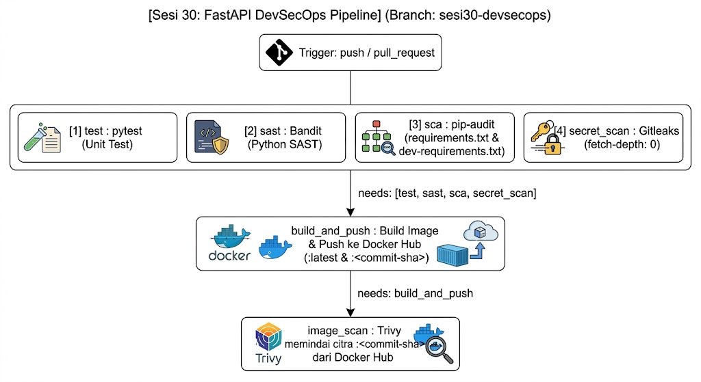

# Notes App FastAPI - DevSecOps Pipeline (Sesi 30)

[](https://github.com/kanjeeng/notes-app-devsecops-lab/actions/workflows/ci.yml)


Tugas Praktikum **DevSecOps Sesi 30** (DigitalSkola). Repositori ini memuat aplikasi **Notes App (FastAPI)** beserta pipeline **GitHub Actions per-job** yang menjalankan pemindaian keamanan otomatis (*Shift-Left Security*), membangun image kontainer, mempublikasikannya ke **Docker Hub**, lalu memindai image tersebut dengan **Trivy**.

> **Penyusun:** Kanjeng Dhimas Cahyoherlina
> **Branch:** `sesi30-devsecops`
> **Image:** [`kanjeeng/notes-app`](https://hub.docker.com/r/kanjeeng/notes-app) (tag `latest` dan `<commit-sha>`)
> **Repo infrastruktur pendamping:** [`devsecops-infrastructure-aws`](https://github.com/kanjeeng/devsecops-infrastructure-aws)

---

## Daftar Isi

1. [Asal Sumber Kode](#1-asal-sumber-kode)
2. [Ringkasan Penugasan](#2-ringkasan-penugasan)
3. [Infrastruktur dan Rancangan Alur FastAPI DevSecOps Pipeline](#3-infrastruktur-dan-rancangan-alur-fastapi-devsecops-pipeline)
4. [Struktur Repositori](#4-struktur-repositori)
5. [Prasyarat](#5-prasyarat)
6. [Panduan Setup Lengkap](#6-panduan-setup-lengkap)
7. [Workflow CI/CD (`ci.yml`)](#7-workflow-cicd-ciyml)
8. [Hasil Baseline dan Perbaikan Dependensi](#8-hasil-baseline-dan-perbaikan-dependensi)
9. [Matriks Skenario Pengujian](#9-matriks-skenario-pengujian)
10. [Bukti Hasil Eksekusi](#10-bukti-hasil-eksekusi)
11. [Keputusan Desain](#11-keputusan-desain)
12. [Troubleshooting](#12-troubleshooting)
13. [Kelanjutan ke Sesi 31](#13-kelanjutan-ke-sesi-31)
14. [Pembersihan Sumber Daya](#14-pembersihan-sumber-daya)

---

## 1. Asal Sumber Kode

Kode aplikasi di-*re-create* dari repositori [`maliqpotter/tugas-project-digital-skola-devops`](https://github.com/maliqpotter/tugas-project-digital-skola-devops) (branch `sesi30-devsecops`). Repositori ini **bukan fork**. Berkas disalin murni lalu diinisialisasi dengan `git init` baru agar riwayat commit bersih. Gitleaks memindai seluruh riwayat commit, sehingga jejak secret pada riwayat lama akan menggagalkan job `secret_scan`.

---

## 2. Ringkasan Penugasan

| Bagian | Ketentuan |
|---|---|
| **A. Workflow Per-Job** | 6 job terpisah: Unit Test (pytest), SAST (Bandit), SCA (pip-audit), Secret Scan (Gitleaks), Build & Push Docker Image, Image Scan (Trivy) |
| **Ketentuan eksekusi** | `build_and_push` hanya berjalan jika `test`, `sast`, `sca`, `secret_scan` lulus (`needs: [...]`). Wajib memakai secret `DOCKERHUB_USERNAME` dan `DOCKERHUB_TOKEN`. Tag minimal `:latest` dan `:<commit-sha>` |
| **B. Perbaikan Dependensi** | Perbarui `requirements.txt` dan `dev-requirements.txt` sampai `pip-audit` bersih, **tanpa** `\|\| true` atau `--ignore-vuln` |

**Pembagian level:**

- **Level 1 (inti):** 6 job per-job, `needs` pada build & push, dua tag di Docker Hub, dependensi bersih dari kerentanan.
- **Level 2 (penguatan):** Dockerfile multi-stage dengan *non-root user* dan base image yang dipin versinya, Trivy tanpa bypass, serta fondasi AWS (EC2 + User Data) untuk memverifikasi image dan menyiapkan server SonarQube Sesi 31.
- **Level 3 (di luar cakupan):** staging deploy, DAST (OWASP ZAP), dan manual approval.

---

## 3. Infrastruktur dan Rancangan Alur FastAPI DevSecOps Pipeline

### 3.1 Arsitektur Terintegrasi (Sesi 30 dan Sesi 31)

Diagram berikut menggambarkan alur dari developer, GitHub-hosted runner, Docker Hub, sampai fondasi AWS (VPC `10.5.0.0/16`) yang dipakai bersama Sesi 30 dan Sesi 31.


*Gambar 1. Arsitektur terintegrasi Sesi 30 dan Sesi 31. File: `docs/images/01-arsitektur-infrastruktur-aws.png`*

| Komponen | Peran |
|---|---|
| Developer dan GitHub Repository (public) | Push/PR memicu pipeline pada branch `sesi30-devsecops` |
| GitHub-hosted runner (`ubuntu-latest`) | Menjalankan seluruh job secara terisolasi |
| Docker Hub (public) | Menyimpan image `kanjeeng/notes-app` dengan tag `latest` dan `<commit-sha>` |
| AWS VPC `10.5.0.0/16`, Public Subnet `10.5.1.0/24` | Satu AZ, Internet Gateway tanpa NAT Gateway (hemat biaya) |
| EC2 `devsecops-node` (t3.medium, Ubuntu 24.04, 30 GiB gp3, IMDSv2) | Verifikasi `docker pull` + `docker run` image Sesi 30; host SonarQube pada Sesi 31 |
| Elastic IP dan DNS `sonar.<domain>` | IP publik tetap untuk Caddy/TLS (aktif penuh Sesi 31) |
| Security Group | SSH 22 hanya dari `admin_cidr`; 80/443 publik; 9000 **tertutup** |

### 3.2 Rancangan Alur Pipeline FastAPI DevSecOps (6 Job Berjenjang)



*Gambar 2. Rancangan alur pipeline Sesi 30. File: `docs/images/02-alur-pipeline-fastapi-devsecops.png`*

```text
Trigger: push / pull_request / workflow_dispatch  (branch sesi30-devsecops)
   │
   ├── [1] test         pytest
   ├── [2] sast         Bandit            (paralel, empat gerbang pengaman)
   ├── [3] sca          pip-audit
   └── [4] secret_scan  Gitleaks (fetch-depth: 0)
   │
   ▼  needs: [test, sast, sca, secret_scan]
[5] build_and_push   Docker Buildx -> Docker Hub (:latest dan :<commit-sha>)
   │
   ▼  needs: [build_and_push]
[6] image_scan       Trivy menarik :<commit-sha> dari Docker Hub (HIGH/CRITICAL)
```

Pada Pull Request, job `build_and_push` dan `image_scan` **dilewati**: `build_and_push` memakai `if: github.event_name != 'pull_request'`, dan `image_scan` bergantung padanya melalui `needs`.

### 3.3 Kebijakan Job

| Job | Perkakas | Kriteria gagal | Kebijakan bypass |
|---|---|---|---|
| `test` | pytest | Ada unit test yang gagal | Dilarang |
| `sast` | Bandit (`-ll`) | Temuan severity **Medium/High** | Tanpa pengabaian error |
| `sca` | pip-audit | Ada paket dengan CVE | Tanpa `--ignore-vuln` |
| `secret_scan` | Gitleaks | Rahasia/token terdeteksi pada commit | Dilarang di-bypass |
| `build_and_push` | Docker CLI dan Buildx | Autentikasi atau build layer gagal | Hanya jalan jika 4 job di atas sukses |
| `image_scan` | Trivy | Temuan **HIGH/CRITICAL** | Memindai image dari Docker Hub tanpa bypass |

> **Zero-bypass policy:** `|| true`, `--ignore-vuln`, `continue-on-error`, dan `--force` dilarang pada seluruh tahapan pengamanan pipeline.

### 3.4 Spesifikasi Infrastruktur AWS

| Komponen | Nilai | Alasan |
|---|---|---|
| Region | `ap-southeast-1` (Singapura) | Latensi rendah, konsisten dengan lab sebelumnya |
| VPC CIDR | `10.5.0.0/16` | Terisolasi dari lab lain (mis. Sesi 27 pada `10.4.0.0/16`) |
| Public Subnet | `10.5.1.0/24` | Satu AZ cukup untuk lab |
| Internet Gateway | Route `0.0.0.0/0` | Tanpa NAT Gateway untuk efisiensi biaya |
| Elastic IP | 1 unit | IP publik tetap untuk DNS dan TLS |
| EC2 | 1 x `t3.medium` (2 vCPU, 4 GiB), Private IP `10.5.1.10` | Cukup untuk Sesi 30 dan Sesi 31 |
| SSH Key Pair | Dibuat Terraform (RSA 4096), `.pem` dikecualikan dari Git | Keamanan kredensial |

**Security Group**

| Port | Sumber | Fungsi |
|---|---|---|
| TCP 22 | `admin_cidr` | SSH administrasi |
| TCP 80 | `0.0.0.0/0` | Tantangan ACME HTTP-01 dan redirect ke HTTPS |
| TCP 443 | `0.0.0.0/0` | SonarQube via Caddy (Sesi 31); runner GitHub memakai IP dinamis |
| TCP 9000 | Tertutup | Backend SonarQube hanya lokal |
| Outbound | `0.0.0.0/0` | Unduh paket dan tarik image dari Docker Hub |

**Estimasi RAM** (puncak Sesi 31 sekitar 3,5 GiB dari 4 GiB, dengan swap 2 GiB sebagai penyangga):

| Layanan | RAM |
|---|---|
| OS + Docker Engine | ~0,6 GiB |
| Caddy | ~0,05 GiB |
| SonarQube Community | ~2–2,5 GiB |
| PostgreSQL | ~0,3 GiB |
| Container Notes App (verifikasi Sesi 30) | ~0,1–0,2 GiB |

**Izin IAM operator:** `AmazonVPCFullAccess`, `AmazonEC2FullAccess`, `IAMReadOnlyAccess`.

---

## 4. Struktur Repositori

Proyek memakai **dua repositori independen**.

### Repo 1: Infrastruktur dan Blueprint (`devsecops-infrastructure-aws`)

```text
devsecops-infrastructure-aws/
├── README.md
├── .gitignore                 # Mengecualikan .tfstate, .pem, .env, *.tfvars
├── terraform/
│   ├── versions.tf  providers.tf  variables.tf
│   ├── network.tf   security-groups.tf  keypair.tf
│   ├── iam.tf       ec2.tf  outputs.tf
│   └── terraform.tfvars.example
├── userdata/devsecops-node.sh         # Docker, tuning kernel, swap 2 GiB, Caddy
├── sonarqube/docker-compose.sonar.yml # Sesi 31
├── caddy/Caddyfile
├── server/                            # enable-sonarqube.sh, verify-node.sh
├── scripts/                           # preflight.sh, my-ip.sh, node-power.sh, verify-remote.sh
└── docs/                              # ARCHITECTURE.md, RUNBOOK.md, SECURITY-NOTES.md
```

### Repo 2: Aplikasi (repositori ini, branch `sesi30-devsecops`)

```text
notes-app-devsecops-lab/
├── .github/workflows/ci.yml   # Pipeline 6-job berjenjang
├── app/
│   ├── main.py                # Titik masuk FastAPI
│   └── models.py              # Skema Pydantic v2
├── tests/test_notes.py        # Unit test pytest
├── docs/images/               # Gambar arsitektur dan bukti eksekusi
├── Dockerfile                 # Multi-stage, non-root user, base image dipin
├── .dockerignore
├── .gitignore
├── pytest.ini                 # pythonpath = .
├── requirements.txt           # Dependensi runtime (dipin, aman CVE)
├── dev-requirements.txt       # pytest, httpx, bandit, pip-audit
└── README.md
```

---

## 5. Prasyarat

| Kebutuhan | Keterangan | Cek |
|---|---|---|
| Akun GitHub | Repo 1 dan Repo 2 (**Repo 2 wajib Public**) | `github.com` |
| Akun Docker Hub | Repository `notes-app` berstatus **Public**, plus Access Token (Read & Write) | `hub.docker.com` |
| Akun AWS + IAM User | Policy: VPC Full, EC2 Full, IAM ReadOnly | `aws sts get-caller-identity` |
| AWS CLI v2 | Region `ap-southeast-1` | `aws --version` |
| Terraform ≥ 1.5 | Provisioning IaC | `terraform version` |
| Git, Python 3.12, Docker | Pengelolaan versi, uji lokal, build image | `git --version`, `python3 --version`, `docker --version` |
| Gitleaks (opsional) | Scan secret lokal sebelum push | `gitleaks version` |
| GitHub CLI `gh` (opsional) | Kelola repo dan secret dari terminal | `gh --version` |
| Domain (opsional Sesi 30) | Untuk `sonar.<domain-anda>` di Sesi 31 | Panel DNS registrar |

**Variabel yang disiapkan:**

| Variabel | Sumber | Dipakai di |
|---|---|---|
| `ADMIN_CIDR` | IP publik Anda + `/32` (`./scripts/my-ip.sh`) | `terraform.tfvars` dan Security Group port 22 |
| `DOCKERHUB_USERNAME` | Username Docker Hub | GitHub Secret, namespace tag image |
| `DOCKERHUB_TOKEN` | Personal Access Token Docker Hub (**bukan** password akun) | GitHub Secret |
| `GH_USER` | Username GitHub | URL remote Repo 1 dan Repo 2 |
| `BASE_DOMAIN`, `ACME_EMAIL` | Domain dan email pribadi (boleh kosong di Sesi 30) | `terraform.tfvars` |

---

## 6. Panduan Setup Lengkap

Urutan pengerjaan: **(A)** siapkan direktori kerja → **(B)** provisioning AWS → **(C)** buat Repo 2 dengan riwayat bersih → **(D)** uji lokal → **(E)** secret dan workflow → **(F)** perbaikan dependensi → **(G)** verifikasi image di EC2.

### A. Direktori Kerja Lokal

```bash
mkdir -p ~/devsecops-lab && cd ~/devsecops-lab
# Hasil akhir:
# ~/devsecops-lab/
# ├── devsecops-infrastructure-aws/   # Repo 1
# └── notes-app-devsecops-lab/        # Repo 2
```

### B. Provisioning Infrastruktur AWS (Repo 1)

**B.1 Publikasikan Repo 1 (tanpa secret):**

```bash
cd ~/devsecops-lab/devsecops-infrastructure-aws
git init -b main
git add -A && git status --short      # pastikan TIDAK ada .pem / .tfvars / .tfstate
git commit -m "feat: initial commit infrastructure blueprint devsecops (Stage 1 & 2)"
git remote add origin https://github.com/<GH_USER>/devsecops-infrastructure-aws.git
git push -u origin main
```

**B.2 Kredensial AWS dan variabel Terraform:**

```bash
aws configure                          # Region: ap-southeast-1, output: json
aws sts get-caller-identity            # catat Account ID dan ARN

cd terraform
cp terraform.tfvars.example terraform.tfvars
../scripts/my-ip.sh                    # salin hasilnya ke admin_cidr
nano terraform.tfvars
```

Pada Tahap 1 (Sesi 30), isi minimal hanya `admin_cidr`. Biarkan `base_domain`, `acme_email`, `enable_sonarqube`, dan `enable_ssm` pada nilai bawaan. `enable_ssm = false` disengaja untuk menjaga hak akses IAM minimum.

**B.3 Preflight, plan, apply:**

```bash
cd ~/devsecops-lab/devsecops-infrastructure-aws
./scripts/preflight.sh                 # cek tools, identitas AWS, init, fmt, validate

cd terraform
terraform plan -out=tfplan             # VPC, Subnet, IGW, RT, SG, Key Pair, EC2, EIP
terraform apply tfplan
terraform output
```

Hasil: **15 resource** dibuat. Output mencakup `elastic_ip`, `instance_id`, `ssh_command`, `sonarqube_url`, dan `dns_instruction`. Kunci privat `devsecops-key.pem` terbentuk di `terraform/` dengan izin `0400`.


*Gambar 3. Hasil `terraform apply` dan `terraform output`. File: `docs/images/03-terraform-apply-output.png`*

**B.4 Verifikasi kesehatan node (User Data butuh 3–5 menit):**

```bash
cd ~/devsecops-lab/devsecops-infrastructure-aws
./scripts/verify-remote.sh
```

| Komponen | Perintah | Hasil yang diharapkan |
|---|---|---|
| Cloud-Init | `cloud-init status --wait` | `status: done` |
| Docker Engine | `docker --version`, `docker compose version` | Versi tampil, user `ubuntu` ada di grup `docker` |
| Kernel tuning | `sysctl vm.max_map_count fs.file-max` | ≥ 524288 dan ≥ 131072 |
| Swap | `swapon --show` | Swap 2 GiB aktif |
| IMDSv2 | Panggilan IMDSv1 tanpa token | HTTP **401 Unauthorized** |
| SonarQube dan Caddy | Cek layanan | Belum aktif (normal di Tahap 1) |
| Security Group | Konsol AWS EC2 | 22 → `admin_cidr`; 80/443 publik; 9000 tertutup |


*Gambar 4. Verifikasi kesehatan node. File: `docs/images/04-verify-remote-node.png`*

Jika cloud-init gagal: `sudo tail -n 100 /var/log/devsecops-userdata.log`.

**B.5 (Opsional) DNS:** buat **Record A** `sonar.<domain-anda>` → `elastic_ip`, TTL 300. Tidak wajib untuk Sesi 30, tetapi mempercepat aktivasi SonarQube HTTPS di Sesi 31.

### C. Membuat Repo 2 dengan Riwayat Git Bersih

**C.1 Buat repositori kosong yang Public:**

```bash
gh repo create notes-app-devsecops-lab --public --description "Notes App FastAPI - DevSecOps Lab Sesi 30"
```

Alternatif lewat web: *New Repository* → nama `notes-app-devsecops-lab` → **Public** → **jangan** centang README, .gitignore, atau license.

**C.2 Unduh sumber, buang riwayat lama, mulai commit baru:**

```bash
# 1. Shallow clone khusus branch sesi30-devsecops
git clone --depth 1 --branch sesi30-devsecops \
  https://github.com/maliqpotter/tugas-project-digital-skola-devops.git notes-app-devsecops-lab

# 2. Masuk ke direktori
cd notes-app-devsecops-lab

# 3. Hapus riwayat Git lama
rm -rf .git

# 4. Inisialisasi ulang
git init -b sesi30-devsecops

# 5. Commit perdana
git add .
git commit -m "chore: initial clean commit for Sesi 30 DevSecOps lab"

# 6. Hubungkan ke remote milik Anda
git remote add origin https://github.com/<GH_USER>/notes-app-devsecops-lab.git
```

### D. Uji Lokal Sebelum Push

```bash
# Virtual environment (Git Bash Windows: source .venv/Scripts/activate)
python3 -m venv .venv
source .venv/bin/activate

python3 -m pip install --upgrade pip
pip install -r requirements.txt -r dev-requirements.txt

# 1. Unit test
PYTHONPATH=. pytest -q

# 2. SAST
bandit -r app -ll

# 3. SCA (harus bersih setelah perbaikan dependensi)
pip-audit -r requirements.txt
pip-audit -r dev-requirements.txt

# 4. Secret scan lokal (opsional)
gitleaks detect --redact -v

# 5. Build dan jalankan image lokal
docker build -t notes-app:local .
docker run --rm -p 8000:8000 notes-app:local
# buka http://localhost:8000/docs
```

### E. Rahasia GitHub dan Workflow

**E.1 Daftarkan secret** (*Settings → Secrets and variables → Actions → New repository secret*):

| Secret | Isi |
|---|---|
| `DOCKERHUB_USERNAME` | Username Docker Hub |
| `DOCKERHUB_TOKEN` | Personal Access Token (hak Read & Write) |

```bash
gh secret set DOCKERHUB_USERNAME --body "<username-dockerhub>"
gh secret set DOCKERHUB_TOKEN        # tempel token saat diminta
```


*Gambar 5. Repository secrets. File: `docs/images/05-github-secrets.png`*

**E.2 Tambahkan workflow dan push:**

```bash
mkdir -p .github/workflows        # salin ci.yml dari bagian 7
git add .github/workflows/ci.yml
git commit -m "feat: add 6-job DevSecOps CI/CD pipeline workflow"
git push -u origin sesi30-devsecops
```

Buka tab **Actions** untuk memantau eksekusi.

### F. Perbaikan Dependensi (Dependency Hardening)

Run pertama gagal pada `sca` (CVE) dan `secret_scan` (riwayat Git). Perbaikannya:

**F.1 Bersihkan riwayat Git:**

```bash
rm -rf .git
git init -b sesi30-devsecops
```

**F.2 Bersihkan virtual environment lama dan instal ulang:**

```bash
rm -rf .venv
python3 -m venv .venv
source .venv/bin/activate          # Git Bash Windows: source .venv/Scripts/activate
```

**F.3 `requirements.txt`:**

```text
fastapi==0.162.0
uvicorn==0.34.0
pydantic==2.10.6
```

**F.4 `dev-requirements.txt`:**

```text
pytest==9.0.3
httpx==0.28.1
bandit==1.8.3
pip-audit==2.7.3
```

**F.5 `pytest.ini`:**

```ini
[pytest]
pythonpath = .
```

**F.6 Instal ulang dan validasi:**

```bash
python3 -m pip install --upgrade pip
pip install -r requirements.txt -r dev-requirements.txt

pip-audit -r requirements.txt          # No known vulnerabilities found
pip-audit -r dev-requirements.txt      # No known vulnerabilities found
```

**F.7 Push riwayat bersih:**

```bash
git add .
git status
git commit -m "security: upgrade dependencies, fix trivy action, and sanitize git history"
git remote add origin https://github.com/<GH_USER>/notes-app-devsecops-lab.git
git push -u origin sesi30-devsecops --force
```

> `--force` di sini hanya untuk menimpa **riwayat Git** pada repo pribadi yang baru dibersihkan. Flag ini tidak dipakai di dalam pipeline pengamanan mana pun.

Mengapa menaikkan FastAPI, bukan hanya `starlette`? FastAPI dibangun di atas Starlette (bagian web) dan Pydantic (validasi data). Memperbarui satu paket transitif secara terpisah sering memicu konflik resolusi versi, sehingga menaikkan FastAPI menyelaraskan seluruh rantai dependensinya.

### G. Verifikasi Image di EC2 (Skenario S30-09)

Setelah pipeline hijau, tarik dan jalankan image dari Docker Hub di server `devsecops-node`:

```bash
# Dari laptop
ssh -i ./devsecops-key.pem ubuntu@<elastic_ip>

# Di dalam EC2
docker --version
docker pull <username-dockerhub>/notes-app:<commit-sha>
docker run -d --name notes-app -p 8000:8000 <username-dockerhub>/notes-app:<commit-sha>

docker ps
curl -s http://localhost:8000/docs | head
# uji dari luar hanya jika port 8000 dibuka sementara pada Security Group, lalu tutup lagi

docker rm -f notes-app
```

<!-- Letakkan screenshot bukti di sini:

-->

---

## 7. Workflow CI/CD (`ci.yml`)

Berkas: `.github/workflows/ci.yml`

```yaml
name: CI DevSecOps Pipeline Sesi 30

on:
  push:
    branches:
      - sesi30-devsecops
  pull_request:
    branches:
      - sesi30-devsecops
  workflow_dispatch:

permissions:
  contents: read

concurrency:
  group: ci-${{ github.ref }}
  cancel-in-progress: true

env:
  PYTHON_VERSION: "3.12"
  IMAGE_NAME: notes-app

jobs:
  # 1. Unit Test (pytest) - S30-01
  test:
    name: Unit Test (pytest)
    runs-on: ubuntu-latest
    timeout-minutes: 10
    steps:
      - name: Checkout Code
        uses: actions/checkout@v4

      - name: Set up Python
        uses: actions/setup-python@v5
        with:
          python-version: ${{ env.PYTHON_VERSION }}
          cache: pip
          cache-dependency-path: |
            requirements.txt
            dev-requirements.txt

      - name: Install Dependencies
        run: |
          python -m pip install --upgrade pip
          pip install -r requirements.txt -r dev-requirements.txt

      - name: Run Pytest
        env:
          PYTHONPATH: .
        run: pytest -q

  # 2. SAST (Bandit) - S30-02
  sast:
    name: SAST (Bandit)
    runs-on: ubuntu-latest
    timeout-minutes: 10
    steps:
      - name: Checkout Code
        uses: actions/checkout@v4

      - name: Set up Python
        uses: actions/setup-python@v5
        with:
          python-version: ${{ env.PYTHON_VERSION }}

      - name: Install Bandit
        run: pip install "$(grep -iE '^bandit==' dev-requirements.txt)"

      - name: Bandit Scan (Medium & High Severity)
        run: bandit -r app -ll

  # 3. SCA (pip-audit) - S30-03 dan S30-04
  sca:
    name: SCA (pip-audit)
    runs-on: ubuntu-latest
    timeout-minutes: 15
    steps:
      - name: Checkout Code
        uses: actions/checkout@v4

      - name: Set up Python
        uses: actions/setup-python@v5
        with:
          python-version: ${{ env.PYTHON_VERSION }}

      - name: Install pip-audit
        run: pip install "$(grep -iE '^pip-audit==' dev-requirements.txt)"

      - name: Audit requirements.txt (Runtime)
        run: pip-audit -r requirements.txt

      - name: Audit dev-requirements.txt (Development)
        run: pip-audit -r dev-requirements.txt

  # 4. Secret Scan (Gitleaks) - S30-05
  secret_scan:
    name: Secret Scan (Gitleaks)
    runs-on: ubuntu-latest
    timeout-minutes: 10
    steps:
      - name: Checkout Code
        uses: actions/checkout@v4
        with:
          fetch-depth: 0          # memindai seluruh riwayat commit

      - name: Run Gitleaks
        uses: gitleaks/gitleaks-action@v2
        env:
          GITHUB_TOKEN: ${{ secrets.GITHUB_TOKEN }}

  # 5. Build & Push Docker Image - S30-07
  build_and_push:
    name: Build & Push Docker Image
    needs: [test, sast, sca, secret_scan]
    if: github.event_name != 'pull_request'
    runs-on: ubuntu-latest
    timeout-minutes: 20
    steps:
      - name: Checkout Code
        uses: actions/checkout@v4

      - name: Set up Docker Buildx
        uses: docker/setup-buildx-action@v3

      - name: Log in to Docker Hub
        uses: docker/login-action@v3
        with:
          username: ${{ secrets.DOCKERHUB_USERNAME }}
          password: ${{ secrets.DOCKERHUB_TOKEN }}

      - name: Build and Push Docker Image (:latest & :<commit-sha>)
        uses: docker/build-push-action@v6
        with:
          context: .
          push: true
          provenance: false
          tags: |
            ${{ secrets.DOCKERHUB_USERNAME }}/${{ env.IMAGE_NAME }}:latest
            ${{ secrets.DOCKERHUB_USERNAME }}/${{ env.IMAGE_NAME }}:${{ github.sha }}
          cache-from: type=gha
          cache-to: type=gha,mode=max

  # 6. Image Scan (Trivy dari Docker Hub) - S30-08
  image_scan:
    name: Image Scan (Trivy)
    needs: [build_and_push]
    runs-on: ubuntu-latest
    timeout-minutes: 15
    steps:
      - name: Trivy Scan on Published Image from Docker Hub
        uses: aquasecurity/trivy-action@v0.35.0
        env:
          TRIVY_USERNAME: ${{ secrets.DOCKERHUB_USERNAME }}
          TRIVY_PASSWORD: ${{ secrets.DOCKERHUB_TOKEN }}
        with:
          image-ref: docker.io/${{ secrets.DOCKERHUB_USERNAME }}/${{ env.IMAGE_NAME }}:${{ github.sha }}
          format: table
          severity: HIGH,CRITICAL
          scanners: vuln
          ignore-unfixed: true
          exit-code: "1"
```

**Penjelasan alur:**

| # | Job | Fungsi |
|---|---|---|
| 1 | `test` | Menjalankan pytest; gagal sekali berarti pipeline berhenti (*fail-fast*) |
| 2 | `sast` | Bandit `-r app -ll`: hanya Medium/High yang memblokir, Low hanya dicatat |
| 3 | `sca` | pip-audit memeriksa `requirements.txt` dan `dev-requirements.txt` terhadap database CVE/PYSEC |
| 4 | `secret_scan` | Gitleaks memindai seluruh riwayat commit (`fetch-depth: 0`) |
| 5 | `build_and_push` | Build multi-stage, push dua tag ke Docker Hub, hanya jika 4 job di atas hijau |
| 6 | `image_scan` | Trivy menarik image dari Docker Hub, gagal bila ada HIGH/CRITICAL (`ignore-unfixed: true` hanya mengecualikan temuan yang memang belum ada patch-nya) |

---

## 8. Hasil Baseline dan Perbaikan Dependensi

### 8.1 Run #1 (Baseline): Status Gagal


*Gambar 6. Run pertama: `test` dan `sast` hijau, `sca` dan `secret_scan` merah, `build_and_push` dan `image_scan` dilewati. File: `docs/images/06-run1-baseline-gagal.png`*

| Job | Status | Temuan |
|---|---|---|
| `test` | ✅ Sukses | Seluruh unit test lulus |
| `sast` | ✅ Sukses | *No issues identified*; 68 baris kode dipindai, 0 isu, 0 `#nosec` |
| `sca` | ❌ Gagal | **7 kerentanan** pada 1 paket transitif: `starlette 0.38.6` (PYSEC-2026-161, 249, 248, 1943, 1941, 2281, 2280) |
| `secret_scan` | ❌ Gagal | `fatal: ambiguous argument ... unknown revision`: rentang commit tidak terselesaikan akibat riwayat/shallow clone |
| `build_and_push` | ⏭ Dilewati | `needs` tidak terpenuhi |
| `image_scan` | ⏭ Dilewati | Bergantung pada `build_and_push` |

| Log | Gambar |
|---|---|
| pytest (lulus) |  |
| Bandit (bersih) |  |
| pip-audit (7 CVE pada starlette) |  |
| Gitleaks (error riwayat) |  |

### 8.2 Analisis Akar Masalah

| No | Temuan | Akar masalah | Tindakan koreksi |
|---|---|---|---|
| 1 | SCA (pip-audit) | `fastapi==0.115.0` dan `uvicorn==0.30.6` mengunci dependensi transitif ke versi lama (`starlette 0.38.6`) dengan CVE aktif | Naikkan dan pin versi: `fastapi==0.162.0`, `uvicorn==0.34.0`, `pydantic==2.10.6`, `pytest==9.0.3` |
| 2 | Secret scan (Gitleaks) | Riwayat commit repo sumber pihak ketiga bermasalah bagi Gitleaks | Re-create repo dengan `git init` baru dan satu commit bersih |
| 3 | SAST (Bandit) | Struktur kode bersih dari Medium/High | Pertahankan tanpa `# nosec` massal |
| 4 | pytest | Logika notes berjalan baik | Pertahankan `pytest.ini` (`pythonpath = .`) |

### 8.3 Run Final: Semua Hijau


*Gambar 7. Seluruh 6 job sukses (total 1 menit 12 detik). File: `docs/images/11-run-final-sukses.png`*

| Job | Durasi | Hasil |
|---|---|---|
| Unit Test (pytest) | 17s | ✅ |
| SAST (Bandit) | 7s | ✅ |
| SCA (pip-audit) | 24s | ✅ No known vulnerabilities found |
| Secret Scan (Gitleaks) | 9s | ✅ 0 kebocoran |
| Build & Push Docker Image | 18s | ✅ |
| Image Scan (Trivy) | 22s | ✅ 0 HIGH/CRITICAL |

### 8.4 Artefak di Docker Hub


*Gambar 8. Repository `kanjeeng/notes-app` di Docker Hub. File: `docs/images/12-dockerhub-tags.png`*

| Atribut | Nilai |
|---|---|
| Repository | `kanjeeng/notes-app` (Public) |
| Tag | `latest` dan `38e9f38a7ab42450ff95a43ca5a9e70384fc0521` (SHA commit) |
| Platform | `linux/amd64` |
| Ukuran terkompresi | ~49,71 MB |

```bash
docker pull kanjeeng/notes-app:latest
docker run --rm -p 8000:8000 kanjeeng/notes-app:latest
```

---

## 9. Matriks Skenario Pengujian

| ID | Level | Skenario | Hasil yang diharapkan | Status |
|---|---|---|---|---|
| S30-01 | 1 | pytest di job `test` | Semua test lulus | ✅ |
| S30-02 | 1 | Bandit di job `sast` | Lulus sesuai ambang (`-ll`) | ✅ |
| S30-03 | 1 | pip-audit **sebelum** perbaikan | Menampilkan CVE (bukti baseline) | ✅ 7 CVE `starlette` |
| S30-04 | 1 | pip-audit **setelah** perbaikan | Tanpa temuan pada kedua berkas | ✅ |
| S30-05 | 1 | Gitleaks pada riwayat bersih | Tanpa secret | ✅ |
| S30-06 | 1 | `needs` pada `build_and_push` | Tidak berjalan bila salah satu job security gagal | ✅ *skipped* pada Run #1 |
| S30-07 | 1 | Push ke Docker Hub | Tag `latest` dan SHA terlihat di repo public | ✅ |
| S30-08 | 1 | Trivy dari Docker Hub | Tanpa HIGH/CRITICAL | ✅ |
| S30-09 | 2 | `docker pull` dan `run` di EC2 | Aplikasi merespons | Lihat bagian 6.G |
| S30-10 | 1 | Tanpa bypass | Tidak ada `\|\| true` atau `--ignore-vuln` di `ci.yml` | ✅ |

Cek S30-10 secara mandiri:

```bash
grep -nE "\|\| *true|--ignore-vuln|continue-on-error|--force" .github/workflows/ci.yml \
  && echo "TERDETEKSI BYPASS" || echo "Bersih: tidak ada bypass"
```

---

## 10. Bukti Hasil Eksekusi

Daftar berkas gambar di `docs/images/` yang dipakai README ini:

| Berkas | Isi |
|---|---|
| `01-arsitektur-infrastruktur-aws.png` | Arsitektur terintegrasi Sesi 30 dan 31 |
| `02-alur-pipeline-fastapi-devsecops.png` | Rancangan alur 6 job pipeline |
| `03-terraform-apply-output.png` | Output `terraform apply` |
| `04-verify-remote-node.png` | Hasil `verify-remote.sh` |
| `05-github-secrets.png` | GitHub repository secrets |
| `06-run1-baseline-gagal.png` | Run #1 (baseline gagal) |
| `07-log-pytest.png` | Log pytest |
| `08-log-bandit.png` | Log Bandit |
| `09-log-pip-audit-baseline.png` | Log pip-audit (7 CVE) |
| `10-log-gitleaks-baseline.png` | Log Gitleaks baseline |
| `11-run-final-sukses.png` | Run final hijau |
| `12-dockerhub-tags.png` | Tag image di Docker Hub |
| `13-ec2-docker-run.png` *(tambahkan sendiri)* | Bukti `docker pull/run` di EC2 |

---

## 11. Keputusan Desain

| Aspek | Pilihan | Alasan |
|---|---|---|
| Runner | GitHub-hosted (`ubuntu-latest`) | Repo wajib public; self-hosted runner pada repo publik berisiko mengeksekusi kode PR pihak luar |
| Urutan scan image | Push dulu, lalu Trivy dari Docker Hub | Sesuai instruksi soal |
| Repositori | 2 repo, riwayat bersih | Mandiri, dan Gitleaks tidak terbebani riwayat lama |
| Infrastruktur | 1 EC2 `t3.medium`, Terraform + User Data | Murah dan dipakai ulang Sesi 31 |
| SonarQube | Disiapkan sekarang, aktif Sesi 31 | Pengerjaan bertahap |
| Dependensi | Upgrade dan pin versi | Satu-satunya cara lulus tanpa bypass |
| Bypass | Dilarang total | `\|\| true`, `--ignore-vuln`, `continue-on-error`, dan `--force` tidak dipakai pada tahap pengamanan |

---

## 12. Troubleshooting

| Gejala | Penyebab | Solusi |
|---|---|---|
| `secret_scan` gagal: `ambiguous argument ... unknown revision` | Riwayat/shallow clone tidak lengkap | Pastikan `fetch-depth: 0` dan riwayat repo bersih (`git init` baru) |
| `secret_scan` gagal karena secret asli ditemukan | Ada kredensial di riwayat commit | Cabut (revoke) kredensialnya, lalu buat ulang repo dengan riwayat bersih |
| `sca` gagal dengan daftar `PYSEC-...` | Dependensi transitif rentan | Naikkan versi paket utama (FastAPI) dan pin; jangan pakai `--ignore-vuln` |
| `pytest` gagal `ModuleNotFoundError: app` | `pythonpath` belum diatur | Tambahkan `pytest.ini` dengan `pythonpath = .` dan/atau `PYTHONPATH=.` |
| `git push` ditolak (*unrelated histories*) setelah `rm -rf .git` | Riwayat lokal baru berbeda dengan remote | Untuk repo pribadi yang dibersihkan: `git push -u origin sesi30-devsecops --force` |
| `docker login` gagal di workflow | Secret salah atau token tanpa izin tulis | Periksa `DOCKERHUB_USERNAME` dan `DOCKERHUB_TOKEN` (PAT Read & Write) |
| Trivy gagal menarik image | Repo Docker Hub private atau kredensial salah | Set repo Public, pastikan `TRIVY_USERNAME`/`TRIVY_PASSWORD` benar |
| Trivy melaporkan HIGH/CRITICAL | Paket OS atau library rentan di image | Perbarui base image atau dependensi, lalu build ulang |
| `ssh` ditolak: *UNPROTECTED PRIVATE KEY FILE* | Izin `.pem` terlalu terbuka | `chmod 400 devsecops-key.pem` |
| SSH timeout | IP publik Anda berubah | Perbarui `admin_cidr` (`./scripts/my-ip.sh`), lalu `terraform apply` |
| cloud-init gagal | Skrip User Data error | `sudo tail -n 100 /var/log/devsecops-userdata.log` |
| Workflow tidak jalan | Push ke branch yang tidak terdaftar | Pastikan branch `sesi30-devsecops` |

---

## 13. Kelanjutan ke Sesi 31

Fondasi yang dibawa dari Sesi 30:

| Elemen | Dari Sesi 30 | Ditambah di Sesi 31 |
|---|---|---|
| Infrastruktur | EC2, Docker, Caddy, DNS | SonarQube diaktifkan (`enable_sonarqube = true`) dan project dibuat |
| Pipeline | Pola job per job tanpa bypass | Job Lint (ESLint), Jest (LCOV), SonarQube Scan, k6 Smoke Test |
| Secrets | Cara menyimpan token di GitHub | `SONAR_HOST_URL` dan `SONAR_TOKEN` |
| Repositori | Repo 2 dengan riwayat bersih | Branch `sesi31-loadtest` (ExpressJS) |

---

## 14. Pembersihan Sumber Daya

Hentikan atau hapus infrastruktur AWS bila tidak dipakai agar biaya tidak berjalan.

```bash
# Hemat biaya: matikan EC2 di luar jam praktikum
cd ~/devsecops-lab/devsecops-infrastructure-aws
./scripts/node-power.sh

# Hapus seluruh infrastruktur (setelah seluruh sesi selesai)
cd terraform
terraform destroy
```

Setelah `terraform destroy`: hapus Record A di panel DNS, hapus berkas `devsecops-key.pem` lokal, dan pastikan tidak ada Elastic IP yang tersisa di konsol AWS.

> Catatan biaya: saat instans dihentikan, volume EBS dan data tetap tersimpan, tetapi Elastic IP dan IPv4 publik tetap dikenai biaya alokasi kecil.

---

## Lisensi dan Kredit

- Sumber kode aplikasi asli: [`maliqpotter/tugas-project-digital-skola-devops`](https://github.com/maliqpotter/tugas-project-digital-skola-devops)
- Disusun oleh **Kanjeng Dhimas Cahyoherlina** untuk program DevOps DigitalSkola.