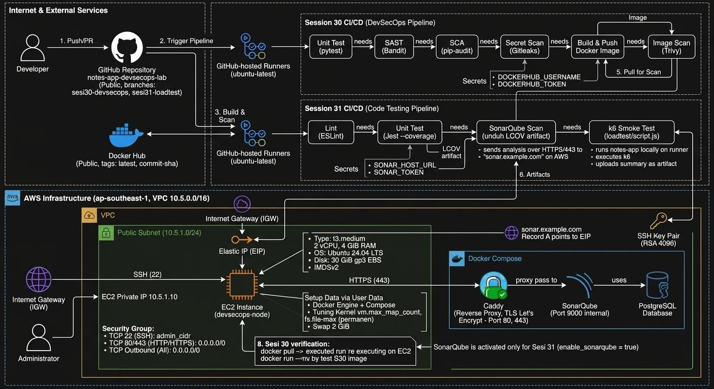
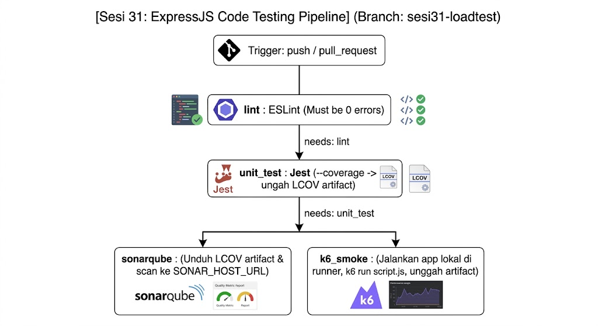

# Notes App ExpressJS - Code Testing Pipeline (Sesi 31)

[](https://github.com/kanjeeng/notes-app-devsecops-lab/actions/workflows/ci.yml)


Tugas Praktikum **Pengujian Code Sesi 31** (DigitalSkola): *Performance Testing Application, Analisis Code, dan Review Code*. Repositori ini memuat aplikasi **Notes App (ExpressJS)** beserta pipeline **GitHub Actions per-job** yang menjalankan **ESLint**, **npm audit**, **Jest + coverage LCOV**, **SonarQube Scan** ke server di AWS EC2 (HTTPS), dan **k6 Smoke Test**.

Praktikum ini adalah **lanjutan Sesi 30 (DevSecOps FastAPI)**. Pola pipeline per-job tanpa bypass dan infrastruktur AWS EC2 dari Sesi 30 dipakai ulang, dengan SonarQube yang diaktifkan pada server yang sama.

> **Penyusun:** Kanjeng Dhimas Cahyoherlina
> **Branch:** `sesi31-loadtest` (repo `notes-app-devsecops-lab`)
> **SonarQube:** `https://sonar.kanjeeng.online` (project `notes-app-express`)
> **Sesi sebelumnya:** branch `sesi30-devsecops` (FastAPI DevSecOps Pipeline)
> **Repo infrastruktur pendamping:** [`devsecops-infrastructure-aws`](https://github.com/kanjeeng/devsecops-infrastructure-aws)

---

## Daftar Isi

1. [Asal Sumber Kode](#1-asal-sumber-kode)
2. [Ringkasan Penugasan](#2-ringkasan-penugasan)
3. [Infrastruktur dan Rancangan Alur ExpressJS Code Testing Pipeline](#3-infrastruktur-dan-rancangan-alur-expressjs-code-testing-pipeline)
4. [Struktur Repositori](#4-struktur-repositori)
5. [Prasyarat](#5-prasyarat)
6. [Panduan Setup Lengkap](#6-panduan-setup-lengkap)
7. [Workflow CI/CD (`ci.yml`)](#7-workflow-cicd-ciyml)
8. [Hasil Baseline dan Perbaikan](#8-hasil-baseline-dan-perbaikan)
9. [Hasil Pipeline, SonarQube, dan k6](#9-hasil-pipeline-sonarqube-dan-k6)
10. [Matriks Skenario Pengujian](#10-matriks-skenario-pengujian)
11. [Bukti Hasil Eksekusi](#11-bukti-hasil-eksekusi)
12. [Keputusan Desain](#12-keputusan-desain)
13. [Troubleshooting](#13-troubleshooting)
14. [Kesinambungan dari Sesi 30](#14-kesinambungan-dari-sesi-30)
15. [Pembersihan Sumber Daya](#15-pembersihan-sumber-daya)

---

## 1. Asal Sumber Kode

Kode aplikasi di-*re-create* dari repositori [`maliqpotter/tugas-project-digital-skola-devops`](https://github.com/maliqpotter/tugas-project-digital-skola-devops) (branch `sesi31-loadtest`). Seperti Sesi 30, repositori ini **bukan fork**. Berkas disalin murni dan diinisialisasi dengan `git init` baru agar riwayat commit bersih. Branch `sesi31-loadtest` didorong ke repositori yang sama dengan Sesi 30 (`notes-app-devsecops-lab`). Berkas workflow tiap branch berdiri sendiri, sehingga `ci.yml` Sesi 30 tidak terpengaruh.

---

## 2. Ringkasan Penugasan

| Bagian | Ketentuan |
|---|---|
| **A. Workflow CI/CD** | Job terpisah (*per-job*) dengan `needs`: `lint` (ESLint), `unit_test` (Jest + coverage), `sonarqube` (SonarQube Scan, official Action), `k6_smoke` (k6 smoke test, di runner CI maupun lokal) |
| **Ketentuan** | `lint` 0 error; `unit_test` lulus dan menghasilkan laporan coverage; SonarQube memakai secret `SONAR_HOST_URL` dan `SONAR_TOKEN`; k6 dibuktikan dengan screenshot |
| **B. Pembersihan** | ESLint 0 error; perbarui `package.json` dan `package-lock.json` sampai pipeline hijau tanpa vulnerability; **tanpa** `\|\| true`, `--force`, `continue-on-error` |
| **Artefak pengumpulan** | Link repo publik dengan minimal 1 workflow run hijau, screenshot dashboard SonarQube, screenshot ringkasan k6, penjelasan 1–2 paragraf |

**Pembagian level:**

- **Level 1 (inti):** 4 job (`lint`, `unit_test`, `sonarqube`, `k6_smoke`), ESLint 0 error, dependensi bersih, seluruh bukti screenshot.
- **Level 2 (penguatan):** bukti `npm audit` (job `dependency_audit`), Quality Gate SonarQube, ringkasan k6 sebagai workflow artifact, SonarQube berjalan di AWS EC2 dengan HTTPS.
- **Level 3 (di luar cakupan):** Load/Stress Test skala besar, staging deployment, DAST (OWASP ZAP).

---

## 3. Infrastruktur dan Rancangan Alur ExpressJS Code Testing Pipeline

### 3.1 Arsitektur Terintegrasi (Sesi 30 dan Sesi 31)

Diagram berikut menggambarkan alur dari developer, GitHub-hosted runner, sampai fondasi AWS (VPC `10.5.0.0/16`) yang dipakai bersama Sesi 30 dan Sesi 31. Pada Sesi 31, runner mengirim analisis ke SonarQube lewat HTTPS (443) dan Caddy.



*Gambar 1. Arsitektur terintegrasi Sesi 30 dan Sesi 31. File: `docs/images/01-arsitektur-infrastruktur-aws.png`*

| Komponen | Peran |
|---|---|
| Developer dan GitHub Repository (public) | Push/PR ke branch `sesi31-loadtest` memicu pipeline |
| GitHub-hosted runner (`ubuntu-latest`) | Menjalankan seluruh job; ESLint, Jest, dan k6 tidak membebani EC2 |
| AWS VPC `10.5.0.0/16`, Public Subnet `10.5.1.0/24` | Satu AZ, Internet Gateway tanpa NAT Gateway |
| EC2 `devsecops-node` (t3.medium, Ubuntu 24.04, 30 GiB gp3, IMDSv2) | Host Docker Compose: SonarQube Community + PostgreSQL |
| Caddy (reverse proxy, TLS Let's Encrypt) | Menerima HTTPS 443 dan meneruskan ke SonarQube `127.0.0.1:9000` |
| Elastic IP dan DNS `sonar.<domain>` | IP publik tetap untuk sertifikat TLS dan `SONAR_HOST_URL` |
| Security Group | SSH 22 hanya dari `admin_cidr`; 80/443 publik; **9000 tertutup** |

### 3.2 Rancangan Alur Pipeline ExpressJS Code Testing



*Gambar 2. Rancangan alur pipeline Sesi 31. File: `docs/images/02-alur-pipeline-expressjs-code-testing.png`*

```text
Trigger: push / pull_request / workflow_dispatch  (branch sesi31-loadtest)
   │
   ├── lint              ESLint (npm run lint)            ┐ paralel,
   └── dependency_audit  npm audit --audit-level=low      ┘ tanpa needs
   │
   ▼  needs: lint
unit_test      Jest + coverage -> upload artifact coverage-lcov
   │
   ├─▶ sonarqube   needs: unit_test   (unduh LCOV, scan ke SONAR_HOST_URL)
   └─▶ k6_smoke    needs: unit_test   (app jalan di runner, k6 run, upload k6-summary)
                                      (sonarqube dan k6_smoke berjalan paralel)
```

### 3.3 Kebijakan Job

| Job | Perkakas | needs | Kriteria gagal | Kebijakan bypass |
|---|---|---|---|---|
| `lint` | ESLint | - | Ada error/penyimpangan aturan | Wajib 0 error, tanpa pengabaian |
| `dependency_audit` | npm audit | - | Ada kerentanan **tingkat apa pun** (`--audit-level=low`) | Tanpa `--force` |
| `unit_test` | Jest | `lint` | Test gagal atau `coverage/lcov.info` tidak terbentuk | Tanpa `--force` |
| `sonarqube` | SonarScanner (official Action) | `unit_test` | Scan gagal, token salah, atau server tidak terjangkau | Membaca LCOV tanpa bypass |
| `k6_smoke` | k6 + Node.js | `unit_test` | Threshold dilanggar atau aplikasi tidak merespons | Ringkasan selalu diunggah sebagai artifact |

> **Zero-bypass policy:** `|| true`, `--force`, `continue-on-error`, dan sejenisnya dilarang pada seluruh tahapan pengamanan pipeline.

### 3.4 Spesifikasi Infrastruktur AWS (dipakai ulang dari Sesi 30)

| Komponen | Nilai | Alasan |
|---|---|---|
| Region | `ap-southeast-1` (Singapura) | Latensi rendah, konsisten dengan lab sebelumnya |
| VPC / Subnet | `10.5.0.0/16` / `10.5.1.0/24` | Terisolasi dari lab lain (Sesi 27 memakai `10.4.0.0/16`) |
| EC2 | 1 x `t3.medium` (2 vCPU, 4 GiB), Private IP `10.5.1.10`, EIP | Cukup untuk SonarQube + PostgreSQL + Caddy |
| Kernel tuning | `vm.max_map_count=524288`, `fs.file-max=131072` | Syarat Elasticsearch milik SonarQube |
| Swap | 2 GiB (otomatis via User Data) | Penyangga memori |
| SonarQube bind | `127.0.0.1:9000` saja | Akses luar wajib lewat Caddy (HTTPS) |

**Security Group**

| Port | Sumber | Fungsi |
|---|---|---|
| TCP 22 | `admin_cidr` | SSH administrasi (periksa ulang IP Anda, karena sering berubah) |
| TCP 80 | `0.0.0.0/0` | ACME HTTP-01 dan redirect ke HTTPS |
| TCP 443 | `0.0.0.0/0` | SonarQube via Caddy; runner GitHub memakai IP dinamis |
| TCP 9000 | Tertutup | Backend SonarQube hanya lokal |
| Outbound | `0.0.0.0/0` | Unduh paket dan image |

**Kompensasi keamanan port 443 publik:** *Force user authentication* aktif, sandi admin bawaan diganti, token analisis dibuat per-project, dan sertifikat TLS sah (Let's Encrypt). k6 dijalankan terhadap aplikasi lokal di runner, sehingga **tidak ada port aplikasi baru yang dibuka di AWS**.

**Estimasi RAM** (puncak sekitar 3,5 GiB dari 4 GiB):

| Layanan | RAM |
|---|---|
| OS + Docker Engine | ~0,6 GiB |
| Caddy | ~0,05 GiB |
| SonarQube Community (Web, Compute, Search) | ~2–2,5 GiB |
| PostgreSQL | ~0,3 GiB |
| Container Notes App (verifikasi Sesi 30) | ~0,1–0,2 GiB |

**Izin IAM operator:** `AmazonVPCFullAccess`, `AmazonEC2FullAccess`, `IAMReadOnlyAccess`.

---

## 4. Struktur Repositori

### Repo 1: Infrastruktur dan Blueprint (`devsecops-infrastructure-aws`, dipakai ulang)

```text
devsecops-infrastructure-aws/
├── terraform/                  # versions, providers, variables, network, security-groups,
│                               # keypair, iam, ec2, outputs, terraform.tfvars.example
├── userdata/devsecops-node.sh  # Docker, tuning kernel, swap 2 GiB, Caddy
├── sonarqube/docker-compose.sonar.yml
├── caddy/Caddyfile
├── server/                     # enable-sonarqube.sh, verify-node.sh
├── scripts/                    # preflight.sh, my-ip.sh, node-power.sh, verify-remote.sh
└── docs/                       # ARCHITECTURE.md, RUNBOOK.md, SECURITY-NOTES.md
```

### Repo 2: Aplikasi (repositori ini, branch `sesi31-loadtest`)

```text
notes-app-sesi31/                    # branch: sesi31-loadtest
├── .github/workflows/ci.yml         # Pipeline per-job (Sesi 31)
├── index.js                         # Entry point aplikasi Express
├── src/
│   ├── app.js                       # Aplikasi Express (rute notes)
│   └── store.js                     # Penyimpanan in-memory
├── tests/app.test.js                # Unit test Jest (supertest)
├── loadtest/script.js               # Skenario k6 smoke test
├── eslint.config.js                 # Konfigurasi ESLint
├── sonar-project.properties         # Project key dan path LCOV
├── package.json                     # Skrip dan overrides dependensi
├── package-lock.json                # Dikunci, CI memakai npm ci
├── Dockerfile
└── docs/
    ├── images/                      # Gambar arsitektur dan bukti eksekusi
    └── evidence/{baseline,after}/   # Keluaran baseline dan setelah perbaikan
```

---

## 5. Prasyarat

| Kebutuhan | Keterangan | Cek |
|---|---|---|
| Fondasi Sesi 30 | Repo 1, EC2 `devsecops-node`, AWS CLI, Terraform, Git | `aws sts get-caller-identity`, `terraform version` |
| Node.js 22 LTS dan npm | Harus sama dengan `NODE_VERSION` di workflow | `node -v`, `npm -v` |
| k6 (Grafana k6) | Smoke test lokal | `k6 version` |
| Domain dan akses panel DNS | **Wajib di Sesi 31**: Record A `sonar.<domain-anda>` | Panel DNS registrar |
| Browser modern | Mengelola dashboard SonarQube | `https://sonar.<domain-anda>` |
| GitHub CLI `gh` (opsional) | Kelola secret dan pantau run | `gh --version` |

**Variabel yang disiapkan:**

| Variabel | Sumber | Dipakai di |
|---|---|---|
| `ADMIN_CIDR` | IP publik + `/32` (`./scripts/my-ip.sh`); **periksa ulang**, IP bisa berubah sejak Sesi 30 | `terraform.tfvars` dan Security Group port 22 |
| `SONAR_DOMAIN` | `sonar.<domain-anda>` | Record A DNS dan `/opt/devsecops/config.env` |
| `ACME_EMAIL` | Email valid untuk Let's Encrypt | `/opt/devsecops/config.env` |
| `SONAR_HOST_URL` | `https://sonar.<domain-anda>` (**tanpa `/` di akhir**) | GitHub Secret |
| `SONAR_TOKEN` | Project Analysis Token dari dashboard SonarQube | GitHub Secret |
| `GH_USER` | Username GitHub | URL remote |

**Struktur direktori kerja lokal** (folder Sesi 30 tidak diubah):

```text
~/devsecops-lab/
├── devsecops-infrastructure-aws/   # Repo 1 (dipakai ulang)
├── notes-app-devsecops-lab/        # Repo 2, branch sesi30-devsecops (FastAPI, selesai)
└── notes-app-sesi31/               # Repo 2, branch sesi31-loadtest (ExpressJS, baru)
```

```bash
cd ~/devsecops-lab
node -v && npm -v
k6 version
```

---

## 6. Panduan Setup Lengkap

Urutan: **(A)** verifikasi fondasi → **(B)** DNS → **(C)** aktivasi SonarQube → **(D)** konfigurasi SonarQube → **(E)** buat branch Sesi 31 dengan riwayat bersih → **(F)** baseline lokal → **(G)** perbaikan → **(H)** secrets, push, dan pantau pipeline → **(I)** k6 lokal.

### A. Verifikasi Fondasi Sesi 30 (Repo 1)

Infrastruktur **tidak dibangun ulang**. Cukup pastikan server hidup dan sehat. Jika belum ada, ikuti panduan Sesi 30.

```bash
cd ~/devsecops-lab/devsecops-infrastructure-aws

# Cek IP publik Anda; jika berubah, perbarui admin_cidr di terraform/terraform.tfvars
./scripts/my-ip.sh

# Hidupkan server bila sebelumnya dihentikan (Elastic IP tetap melekat)
./scripts/node-power.sh status
./scripts/node-power.sh start

# Verifikasi kesehatan node
./scripts/verify-remote.sh
```

Jika `admin_cidr` berubah: `cd terraform && terraform apply`.


*Gambar 3. `terraform output`. File: `docs/images/03-terraform-output.png`*


*Gambar 4. Verifikasi kesehatan node. File: `docs/images/04-verify-remote-node.png`*

| Komponen | Hasil yang diharapkan |
|---|---|
| `cloud-init status --wait` | `status: done` |
| Docker | Versi tampil, user `ubuntu` di grup `docker` |
| Kernel | `vm.max_map_count` ≥ 524288, `fs.file-max` ≥ 131072 |
| Swap | 2 GiB aktif |
| IMDSv2 | IMDSv1 tanpa token → HTTP 401 |
| SonarQube dan Caddy | Belum aktif sampai langkah C |

### B. DNS (Wajib di Sesi 31)

Buat **Record A** `sonar.<domain-anda>` → `elastic_ip`, TTL 300 detik. Verifikasi propagasi:

```bash
nslookup sonar.<domain-anda>        # atau: dig +short sonar.<domain-anda>
# IP harus sama persis dengan elastic_ip
```


*Gambar 5. Hasil `nslookup`. File: `docs/images/05-dns-nslookup-sonar.png`*

> Jangan lanjut ke langkah C sebelum DNS benar. Caddy memerlukan validasi HTTP-01 Let's Encrypt lewat port 80.

### C. Aktivasi SonarQube dan Caddy HTTPS (Tahap 2)

Berkas Docker Compose dan Caddy sudah disiapkan User Data di `/opt/devsecops/`.

```bash
ssh -i ./devsecops-key.pem ubuntu@<elastic_ip>

# di dalam server
sudo nano /opt/devsecops/config.env
#   SONAR_DOMAIN=sonar.<domain-anda>
#   ACME_EMAIL=<email-anda>
sudo /opt/devsecops/enable-sonarqube.sh
```

Skrip melakukan empat hal: (1) menjalankan SonarQube dan PostgreSQL via Docker Compose, (2) mengaktifkan Caddy dengan SSL Let's Encrypt, (3) memantau `/api/system/status` sampai `UP`, (4) menampilkan URL akses.

**Verifikasi:**

| Pemeriksaan | Perintah | Hasil |
|---|---|---|
| Kontainer | `docker ps` (di server) | `sonarqube` dan `sonar-db` Up (db: healthy) |
| Status aplikasi | `curl -s http://127.0.0.1:9000/api/system/status` | `{"status":"UP",...}` |
| Caddy | `systemctl is-active caddy` | `active` |
| HTTPS | `curl -I https://sonar.<domain-anda>` (dari laptop) | HTTP 200/302, sertifikat valid |
| Port 9000 | `curl -m 5 http://<elastic_ip>:9000` (dari laptop) | Timeout (aman) |


*Gambar 6. Kontainer SonarQube/PostgreSQL dan status `UP`. File: `docs/images/06-sonarqube-docker-ps-status.png`*


*Gambar 7. HTTPS 200 OK dan port 9000 timeout. File: `docs/images/07-sonarqube-https-dan-port-9000.png`*

### D. Konfigurasi Awal SonarQube (browser)

1. **Login pertama:** `admin` / `admin`, lalu ganti ke sandi baru yang kuat.
2. **Force authentication:** *Administration → Configuration → General Settings → Security* → aktifkan **Force user authentication** → *Save*. Wajib karena server dapat diakses publik lewat 443.
3. **Buat project lokal:** *Projects → Create project → Create a local project*:
   - Project display name: `Notes App Express`
   - Project key: `notes-app-express` (**harus sama persis** dengan `sonar.projectKey`)
   - Main branch name: `sesi31-loadtest`
4. **New code definition:** pilih *Follows the instance's default* (Previous version), lalu selesaikan pembuatan project. Pada halaman *Analysis Method* pilih **With GitHub Actions**.
5. **Token analisis:** *My Account → Security → Generate Tokens*. Nama `github-actions-sesi31`, tipe **Project Analysis Token**, project `Notes App Express`, masa aktif sesuai kebutuhan. **Salin token sekarang**, karena hanya tampil sekali.


*Gambar 8. Pilihan metode analisis (With GitHub Actions). File: `docs/images/08-sonarqube-analysis-method.png`*


*Gambar 9. Token `github-actions-sesi31` (Project Analysis Token). File: `docs/images/09-sonarqube-token-analisis.png`*

> Sembunyikan atau potong bagian token sebelum screenshot dipublikasikan. Jangan pernah memuat nilai token di repositori.

### E. Buat Branch `sesi31-loadtest` dengan Riwayat Git Bersih

Repositori GitHub `notes-app-devsecops-lab` sudah ada dari Sesi 30, jadi **tidak perlu membuat repo baru**.

**E.1 Pastikan kondisi remote:**

```bash
# Buka repo di jendela incognito: harus Public, branch sesi30-devsecops utuh
git ls-remote --heads https://github.com/<GH_USER>/notes-app-devsecops-lab.git
# Branch sesi31-loadtest BELUM boleh ada
```

**E.2 Unduh sumber, buang riwayat lama, commit bersih:**

```bash
cd ~/devsecops-lab

# 1. Shallow clone khusus branch sesi31-loadtest, ke folder terpisah
git clone --depth 1 --branch sesi31-loadtest \
  https://github.com/maliqpotter/tugas-project-digital-skola-devops.git notes-app-sesi31

# 2. Masuk dan hapus riwayat Git lama
cd notes-app-sesi31
rm -rf .git

# 3. Inisialisasi ulang dengan branch sesi31-loadtest, commit perdana
git init -b sesi31-loadtest
git add .
git commit -m "chore: initial clean commit for Sesi 31 lab"

# 4. Hubungkan ke repo Sesi 30 dan dorong sebagai branch BARU
git remote add origin https://github.com/<GH_USER>/notes-app-devsecops-lab.git
git push -u origin sesi31-loadtest
```

> Branch ini baru di remote, jadi **`--force` tidak diperlukan**. Jika Git menolak (*rejected* atau *unrelated histories*), hentikan dan periksa apakah `sesi31-loadtest` sudah ada. **Jangan pernah force push ke `sesi30-devsecops`.**

**E.3 Periksa hasil salinan:**

```bash
find . -path ./node_modules -prune -o -type f -not -path "./.git/*" -print | sort | head -60
cat package.json
ls .github/workflows 2>/dev/null; cat .github/workflows/ci.yml 2>/dev/null
```

| Berkas | Fungsi |
|---|---|
| Kode Express (`index.js`, `src/`) dan `tests/` | Sumber untuk ESLint, Jest, dan SonarQube |
| `package.json`, `package-lock.json` | Dependensi (CI memakai `npm ci`); catat skrip `lint`, `test`, `start` |
| Konfigurasi ESLint | Aturan linting |
| Konfigurasi Jest | Coverage dengan reporter LCOV |
| `loadtest/script.js` | Skenario k6; catat URL target, VU, durasi, threshold |
| `sonar-project.properties` | Project key dan path LCOV |

### F. Baseline Lokal (sebelum perbaikan)

```bash
cd ~/devsecops-lab/notes-app-sesi31
mkdir -p docs/evidence/baseline docs/evidence/after
cat package.json | tee docs/evidence/baseline/package.json.txt
cat loadtest/script.js

# 1. Instal bersih
rm -rf node_modules
npm ci 2>&1 | tee docs/evidence/baseline/npm-ci.before.txt

# 2. ESLint
npx eslint . 2>&1 | tee docs/evidence/baseline/eslint.before.txt

# 3. Jest + coverage LCOV
npm test -- --coverage --coverageReporters=lcov --coverageReporters=text 2>&1 \
  | tee docs/evidence/baseline/jest.before.txt
ls coverage/lcov.info

# 4. npm audit
npm audit 2>&1 | tee docs/evidence/baseline/npm-audit.before.txt
npm audit --json > docs/evidence/baseline/npm-audit.before.json
```

Skrip npm yang tersedia: `start` (`node index.js`), `dev` (`nodemon index.js`), `test` (`jest --coverage --runInBand`), `lint` (`eslint .`), `k6` (`k6 run loadtest/script.js`). Hasil baseline dibahas di [bagian 8](#8-hasil-baseline-dan-perbaikan).

### G. Perbaikan Kode dan Dependensi

**G.1 ESLint: daftarkan global `__ENV` milik k6.** Tambahkan komentar anotasi pada baris pertama `loadtest/script.js`, tanpa mematikan aturan linter:

```js
// loadtest/script.js
/* global __ENV */
import http from 'k6/http';
import { sleep, check } from 'k6';
```

**G.2 Dependensi: tambahkan `overrides` di `package.json`.** Hasil akhir:

```json
{
  "name": "notes-app-sonar",
  "version": "1.0.0",
  "main": "index.js",
  "type": "commonjs",
  "scripts": {
    "start": "node index.js",
    "dev": "nodemon index.js",
    "test": "jest --coverage --runInBand",
    "lint": "eslint .",
    "k6": "k6 run loadtest/script.js"
  },
  "dependencies": {
    "body-parser": "^1.20.3",
    "express": "^4.19.2"
  },
  "devDependencies": {
    "@eslint/eslintrc": "^3.3.1",
    "eslint": "^9.9.0",
    "jest": "^29.7.0",
    "nodemon": "^3.1.0",
    "supertest": "^7.0.0"
  },
  "overrides": {
    "deepmerge": "2.0.1",
    "minimatch": "^11.0.1",
    "glob": "^14.0.2",
    "test-exclude": "^7.0.1",
    "babel-plugin-istanbul": "^7.0.0"
  }
}
```

**G.3 Bangun ulang pohon paket dari kondisi bersih:**

```bash
rm -rf node_modules package-lock.json
npm install
```

**G.4 Validasi lokal (ketiga-tiganya harus bersih):**

```bash
npm run lint                       # 0 errors, 0 warnings
npm test                           # semua lulus, coverage/lcov.info terbentuk
npm audit --audit-level=low        # found 0 vulnerabilities
```

**G.5 (Opsional, disarankan) Perbaikan temuan SonarQube `javascript:S5689`.** Di `src/app.js`, sembunyikan header `X-Powered-By` tepat setelah inisialisasi Express:

```js
const app = express();
app.disable('x-powered-by');
app.use(bodyParser.json());
```

Pastikan baris baru ini tercakup oleh unit test. Kebutuhan coverage New Code adalah ≥ 80%.

> **Jangan jalankan `npm audit fix --force`.** Perintah itu menurunkan Jest dari `^29.7.0` ke `25.1.0` dan merusak test serta kompatibilitas ESLint modern.

### H. Secrets, Push, dan Pantau Pipeline

**H.1 Daftarkan GitHub Secrets** (*Settings → Secrets and variables → Actions*, atau `gh`):

```bash
cd ~/devsecops-lab/notes-app-sesi31
gh secret set SONAR_HOST_URL --body "https://sonar.<domain-anda>"   # tanpa "/" di akhir
gh secret set SONAR_TOKEN                                           # tempel token saat diminta
gh secret list
```

**H.2 Tambahkan workflow dan konfigurasi Sonar** (salin dari bagian 7), lalu push:

```bash
mkdir -p .github/workflows
git status && git log --oneline
git add .github/workflows/ci.yml sonar-project.properties package.json package-lock.json src loadtest docs
git commit -m "feat: add modular per-job CI pipeline with lint, test, sonarqube, and k6"
git push origin sesi31-loadtest
gh run watch
```

**Ekspektasi alur:** `lint` dan `dependency_audit` jalan paralel → `unit_test` setelah `lint` hijau → `sonarqube` dan `k6_smoke` jalan paralel setelah `unit_test` hijau.

**H.3 Verifikasi hasil:**

1. **Dashboard SonarQube:** buka `https://sonar.<domain-anda>`, pastikan project `Notes App Express` memuat analisis terbaru yang waktunya sinkron dengan run GitHub Actions.
2. **Tab Actions:** semua job bercentang hijau. Buka repo di mode incognito untuk memastikan run bisa dilihat publik tanpa login (S31-09).

### I. k6 Smoke Test Lokal (bukti screenshot S31-05)

Instal k6 (lihat dokumentasi resmi Grafana k6; contoh: `winget install k6 --source winget` di Windows, `brew install k6` di macOS). Lalu jalankan:

```bash
# Terminal 1: jalankan aplikasi
npm start                                   # port 3000

# Terminal 2: jalankan k6
k6 run loadtest/script.js
# atau dengan target dan ringkasan eksplisit:
k6 run --summary-export=k6-summary.json -e BASE_URL=http://127.0.0.1:3000 loadtest/script.js
```

Threshold pada skrip: `http_req_duration: p(95) < 400` ms dan `http_req_failed: rate < 0.01`. Simpan screenshot ringkasan sebagai `docs/images/30-k6-smoke-lokal.png`.

---

## 7. Workflow CI/CD (`ci.yml`)

Berkas: `.github/workflows/ci.yml`

```yaml
name: CI - Sesi 31 Pengujian Code

on:
  push:
    branches: [sesi31-loadtest]
  pull_request:
    branches: [sesi31-loadtest]
  workflow_dispatch:

permissions:
  contents: read

concurrency:
  group: ci-${{ github.ref }}
  cancel-in-progress: true

env:
  NODE_VERSION: "22"
  APP_PORT: "3000"

jobs:
  # 1. Lint (S31-01)
  lint:
    name: Lint (ESLint)
    runs-on: ubuntu-latest
    timeout-minutes: 10
    steps:
      - uses: actions/checkout@v4
      - uses: actions/setup-node@v4
        with:
          node-version: ${{ env.NODE_VERSION }}
          cache: npm
      - run: npm ci
      - name: ESLint
        run: npm run lint

  # SCA npm (S31-07, Level 2)
  dependency_audit:
    name: SCA (npm audit)
    runs-on: ubuntu-latest
    timeout-minutes: 10
    steps:
      - uses: actions/checkout@v4
      - uses: actions/setup-node@v4
        with:
          node-version: ${{ env.NODE_VERSION }}
          cache: npm
      - run: npm ci
      - name: npm audit (gagal pada temuan tingkat apa pun)
        run: npm audit --audit-level=low

  # 2. Unit Test + coverage (S31-02)
  unit_test:
    name: Unit Test (Jest + coverage)
    needs: lint
    runs-on: ubuntu-latest
    timeout-minutes: 15
    steps:
      - uses: actions/checkout@v4
      - uses: actions/setup-node@v4
        with:
          node-version: ${{ env.NODE_VERSION }}
          cache: npm
      - run: npm ci
      - name: Jest dengan coverage (LCOV)
        run: npm test -- --coverage --coverageReporters=lcov --coverageReporters=text
      - name: Unggah laporan LCOV
        uses: actions/upload-artifact@v4
        with:
          name: coverage-lcov
          path: coverage/lcov.info
          if-no-files-found: error

  # 3. SonarQube Scan (S31-03)
  sonarqube:
    name: SonarQube Scan
    needs: unit_test
    runs-on: ubuntu-latest
    timeout-minutes: 20
    steps:
      - uses: actions/checkout@v4
        with:
          fetch-depth: 0
      - name: Unduh laporan LCOV
        uses: actions/download-artifact@v4
        with:
          name: coverage-lcov
          path: coverage
      - name: SonarQube Scan
        uses: SonarSource/sonarqube-scan-action@v5
        env:
          SONAR_TOKEN: ${{ secrets.SONAR_TOKEN }}
          SONAR_HOST_URL: ${{ secrets.SONAR_HOST_URL }}

  # 4. k6 Smoke Test (S31-06)
  k6_smoke:
    name: k6 Smoke Test
    needs: unit_test
    runs-on: ubuntu-latest
    timeout-minutes: 15
    steps:
      - uses: actions/checkout@v4
      - uses: actions/setup-node@v4
        with:
          node-version: ${{ env.NODE_VERSION }}
          cache: npm
      - run: npm ci
      - name: Jalankan aplikasi di runner
        env:
          PORT: ${{ env.APP_PORT }}
        run: |
          nohup npm start > app.log 2>&1 &
          for i in $(seq 1 30); do
            if curl -s -o /dev/null "http://127.0.0.1:${APP_PORT}/"; then echo "App siap"; exit 0; fi
            sleep 1
          done
          echo "App tidak merespons"; cat app.log; exit 1
      - uses: grafana/setup-k6-action@v1
      - name: k6 run
        run: k6 run --summary-export=k6-summary.json -e BASE_URL=http://127.0.0.1:${APP_PORT} loadtest/script.js
      - name: Unggah ringkasan k6
        if: always()
        uses: actions/upload-artifact@v4
        with:
          name: k6-summary
          path: |
            k6-summary.json
            app.log
```

**Berkas `sonar-project.properties`:**

```properties
sonar.projectKey=notes-app-express
sonar.projectName=Notes App Express (Sesi 31)

# Direktori sumber utama
sonar.sources=src
sonar.exclusions=node_modules/**,coverage/**,loadtest/**,docs/**,scripts/**,.github/**,**/*.test.js,**/*.spec.js,tests/**,__tests__/**
sonar.tests=tests
sonar.test.inclusions=**/*.test.js,**/*.spec.js,tests/**,__tests__/**
sonar.javascript.lcov.reportPaths=coverage/lcov.info
sonar.coverage.exclusions=**/*.test.js,**/*.spec.js,tests/**,__tests__/**,loadtest/**
sonar.sourceEncoding=UTF-8
```

**Penjelasan alur:**

| Job | Fungsi |
|---|---|
| `lint` | `npm run lint` (ESLint); satu error menghentikan pipeline |
| `dependency_audit` | `npm audit --audit-level=low` memeriksa seluruh pohon dependensi |
| `unit_test` | Jest dengan coverage; mengunggah `coverage/lcov.info` sebagai artifact (`if-no-files-found: error` memastikan pipeline gagal bila LCOV tidak terbentuk) |
| `sonarqube` | Mengunduh LCOV ke `coverage/`, memindai ke `SONAR_HOST_URL`; `fetch-depth: 0` agar deteksi *new code* berjalan |
| `k6_smoke` | Menjalankan aplikasi di runner (port 3000), menunggu siap, menjalankan k6, mengunggah `k6-summary.json` dan `app.log` |

---

## 8. Hasil Baseline dan Perbaikan

### 8.1 Baseline (sebelum perbaikan)

| No | Komponen | Temuan baseline | Tindakan koreksi |
|---|---|---|---|
| 1 | `npm ci` | 442 paket terpasang, 443 diaudit (40 detik); **21 vulnerabilities** | Perbarui via `overrides` |
| 2 | ESLint | **1 error**: `'__ENV' is not defined (no-undef)` di `loadtest/script.js` baris 17 | Anotasi `/* global __ENV */` |
| 3 | npm audit | **21 kerentanan: 7 low, 3 moderate, 10 high, 1 critical** | `overrides` dan instal ulang bersih |
| 4 | Jest | 5/5 test lulus; Statements **80,3%**, Lines **87,93%**; `coverage/lcov.info` terbentuk | Pertahankan tetap hijau |
| 5 | `ci.yml` | Belum ada workflow pada sumber | Disusun ulang per-job tanpa bypass |
| 6 | Riwayat Git | Bersih lewat `git init` baru | Dipertahankan |


*Gambar 10. `package.json` baseline. File: `docs/images/10-baseline-package-json.png`*


*Gambar 11. Skrip k6 baseline. File: `docs/images/11-baseline-loadtest-script.png`*


*Gambar 12. `npm ci` baseline (21 vulnerabilities). File: `docs/images/12-baseline-npm-ci.png`*


*Gambar 13. ESLint: 1 error `__ENV`. File: `docs/images/13-baseline-eslint-error.png`*


*Gambar 14. Jest baseline dan `coverage/lcov.info`. File: `docs/images/14-baseline-jest-coverage.png`*


*Gambar 15. `npm audit`: 7 low, 3 moderate, 10 high, 1 critical. File: `docs/images/15-baseline-npm-audit-21-vuln.png`*

**Rincian kerentanan baseline** (paket terdampak antara lain `proxy-addr`, `body-parser`, `express`, `minimatch`, `brace-expansion`, `js-yaml`, `flatted`, `browserslist`, `picomatch`, `form-data`, `qs`, `ajv`, `deepmerge`):

| Tingkat | Contoh |
|---|---|
| Critical/High | IP spoofing `proxy-addr` (GHSA-jqcg-44mw-w2h4); DoS `body-parser` dan `express` (GHSA-v422-hmwv-36x6, GHSA-27r3-jxmh-p828); ReDoS `minimatch` dan `brace-expansion` |
| Moderate/Low | ReDoS `ajv`; parsing `qs`; Prototype Pollution `deepmerge` (GHSA-gcqx-w48m-w2h4) via `jest-config` |

### 8.2 Perbaikan ESLint

Variabel `__ENV` adalah global bawaan runtime k6, sedangkan ESLint dikonfigurasi untuk Node.js (CommonJS). Anotasi `/* global __ENV */` mendaftarkannya sebagai global yang sah **tanpa mematikan aturan `no-undef`**. Hasil: **0 errors, 0 warnings**.


*Gambar 16. Anotasi `/* global __ENV */`. File: `docs/images/16-fix-eslint-global-env.png`*

### 8.3 Perbaikan Dependensi

| Komponen | Sebelum | Sesudah |
|---|---|---|
| `dependencies` | `body-parser ^1.20.3`, `express ^4.19.2` | Sama |
| `devDependencies` | `@eslint/eslintrc ^3.3.1`, `eslint ^9.9.0`, `jest ^29.7.0`, `nodemon ^3.1.0`, `supertest ^7.0.0` | Sama |
| `overrides` | (tidak ada) | `deepmerge 2.0.1`, `minimatch ^11.0.1`, `glob ^14.0.2`, `test-exclude ^7.0.1`, `babel-plugin-istanbul ^7.0.0` |


*Gambar 17. `npm outdated`. File: `docs/images/17-npm-outdated.png`*

**Mengapa `npm audit fix --force` dilarang:** perintah itu menurunkan Jest `^29.7.0` menjadi `25.1.0` (rilis 2020), sehingga merusak unit test dan kompatibilitas linter modern.

**Insiden di CI dan penyelesaiannya.** Setelah `glob` dinaikkan ke `^14.0.2`, lingkungan CI yang bersih gagal pada `unit_test` dengan galat `TypeError ... "original" argument must be of type function`. Penyebabnya konflik antara `glob` v14 dan `test-exclude` / `babel-plugin-istanbul` lama bawaan Jest. Solusinya menambahkan `test-exclude ^7.0.1` dan `babel-plugin-istanbul ^7.0.0` ke `overrides`.


*Gambar 18. Galat di CI sebelum override tambahan. File: `docs/images/18-ci-error-babel-istanbul.png`*

### 8.4 Validasi Lokal Setelah Perbaikan

| Pemeriksaan | Hasil |
|---|---|
| `npm run lint` | 0 errors, 0 warnings |
| `npm test` | Semua lulus; Lines **87,93%** |
| `npm audit --audit-level=low` | **found 0 vulnerabilities** |


*Gambar 19. Instal ulang bersih, 0 vulnerabilities. File: `docs/images/19-after-npm-install-0-vuln.png`*


*Gambar 20. Jest lokal setelah perbaikan. File: `docs/images/20-after-jest-lokal.png`*

---

## 9. Hasil Pipeline, SonarQube, dan k6

### 9.1 Run GitHub Actions: Hijau


*Gambar 21. Seluruh job sukses. File: `docs/images/21-run-ci-sukses.png`*

| Job | Hasil |
|---|---|
| Lint (ESLint) | ✅ 0 errors, 0 warnings |
| SCA (npm audit) | ✅ `found 0 vulnerabilities` (`--audit-level=low`) |
| Unit Test (Jest + coverage) | ✅ 5/5 lulus, LCOV diunggah sebagai artifact |
| SonarQube Scan | ✅ Terkirim ke server, Quality Gate Passed |
| k6 Smoke Test | ✅ Threshold lulus, `k6-summary.json` diunggah |


*Gambar 22. Log job `lint`. File: `docs/images/22-log-ci-eslint.png`*


*Gambar 23. Log `npm ci` dan `npm audit --audit-level=low`. File: `docs/images/23-log-ci-npm-audit.png`*


*Gambar 24. Log job `unit_test` beserta tabel coverage. File: `docs/images/24-log-ci-jest-coverage.png`*

**Ringkasan coverage Jest:**

| Metrik | Nilai |
|---|---|
| Statements | 80,3% |
| Branches | 41,66% |
| Functions | 77,77% |
| Lines | 87,93% |
| Baris belum tercakup | `app.js` 18-20; `store.js` 8-9, 23, 60 |

### 9.2 Dashboard SonarQube

Project `Notes App Express (Sesi 31)`, `https://sonar.<domain-anda>`:

| Aspek | Hasil |
|---|---|
| **Quality Gate** | **Passed** |
| Reliability | Rating **A**, 0 bug |
| Maintainability | Rating **A**, 0 code smell, duplikasi 0,0% |
| Security (awal) | Rating **B**, 1 issue low (`javascript:S5689`), 0 security hotspot |
| Coverage (Overall Code) | 74,1% dari 61 baris yang harus dicakup |


*Gambar 25. Quality Gate Passed, Overall Code. File: `docs/images/25-sonarqube-quality-gate-overall.png`*

> Coverage Sonar (74,1%) berbeda dari Line Coverage Jest (87,93%) karena SonarQube menghitung coverage hanya pada berkas `sonar.sources=src` dan memakai definisi baris/kondisi miliknya sendiri.

**Temuan `javascript:S5689`:** *"This framework implicitly discloses version information by default."* Express secara bawaan mengirim header `X-Powered-By: Express` (`src/app.js` baris 6, `const app = express();`). Temuan berstatus Low sehingga Quality Gate tetap lulus.


*Gambar 26. Issue `javascript:S5689` (Security, Low). File: `docs/images/26-sonarqube-issue-s5689.png`*


*Gambar 27. Lokasi issue pada `src/app.js`. File: `docs/images/27-sonarqube-issue-detail-app-js.png`*

**Mitigasi (Shift-Left):** tambahkan `app.disable('x-powered-by');` tepat setelah inisialisasi Express.


*Gambar 28. `app.disable('x-powered-by')`. File: `docs/images/28-fix-x-powered-by.png`*

**Hasil setelah mitigasi (tab New Code, sejak 2 November 2026):**

| Metrik New Code | Hasil | Syarat |
|---|---|---|
| New issues | **0** | = 0 |
| Coverage | **100%** (1 baris baru) | ≥ 80,0% |
| Duplications | **0,0%** | ≤ 3,0% |
| Security Hotspots | **0** (Rating A) | - |


*Gambar 29. Quality Gate Passed, New Code. File: `docs/images/29-sonarqube-new-code-passed.png`*

### 9.3 k6 Smoke Test

| Parameter | Nilai |
|---|---|
| Skrip | `loadtest/script.js` |
| Target | `BASE_URL` (default `http://localhost:3000`; di CI `http://127.0.0.1:3000`) |
| Skenario | `POST /notes` (cek 201) lalu `GET /notes` (cek 200) |
| Threshold | `http_req_duration: p(95) < 400 ms`; `http_req_failed: rate < 0.01` |
| Artefak CI | `k6-summary` (`k6-summary.json` dan `app.log`) |

<!-- Letakkan screenshot bukti k6 di sini:

*Gambar 30. Ringkasan k6 smoke test lokal (S31-05).*


*Gambar 31. Artifact `k6-summary` pada run Actions (S31-06).*
-->

---

## 10. Matriks Skenario Pengujian

| ID | Level | Skenario | Hasil yang diharapkan | Status |
|---|---|---|---|---|
| S31-01 | 1 | ESLint di job `lint` | Nol error | ✅ 0 errors, 0 warnings |
| S31-02 | 1 | Jest di job `unit_test` | Semua lulus, coverage tampil | ✅ 5/5, Lines 87,93% |
| S31-03 | 1 | Scan di job `sonarqube` | Berhasil, hasil tampil di dashboard | ✅ Quality Gate Passed |
| S31-04 | 1 | Screenshot SonarQube | Memuat project dan metrik utama | ✅ Gambar 25–29 |
| S31-05 | 1 | k6 smoke lokal | Output dan threshold lulus, screenshot disimpan | Lampirkan screenshot (Gambar 30) |
| S31-06 | 2 | k6 smoke di CI | Ringkasan tersedia sebagai artifact | Lampirkan screenshot artifact (Gambar 31) |
| S31-07 | 1 | `npm audit` setelah perbaikan | Tanpa vulnerability | ✅ `found 0 vulnerabilities` |
| S31-08 | 1 | Pemeriksaan bypass | Tidak ada pola bypass pada `ci.yml` | ✅ (perintah di bawah) |
| S31-09 | 1 | Run sukses pada repo public | Terlihat di tab Actions tanpa login | ✅ Verifikasi via incognito |

Cek S31-08 secara mandiri:

```bash
grep -nE "\|\| *true|--force|continue-on-error" .github/workflows/ci.yml \
  && echo "TERDETEKSI BYPASS" || echo "Bersih: tidak ada bypass"
```

---

## 11. Bukti Hasil Eksekusi

Gambar yang tersimpan di `docs/images/`:

| Berkas | Isi |
|---|---|
| `01-arsitektur-infrastruktur-aws.png` | Arsitektur terintegrasi Sesi 30 dan 31 |
| `02-alur-pipeline-expressjs-code-testing.png` | Rancangan alur pipeline Sesi 31 |
| `03-terraform-output.png` | `terraform output` |
| `04-verify-remote-node.png` | Hasil `verify-remote.sh` |
| `05-dns-nslookup-sonar.png` | Verifikasi DNS |
| `06-sonarqube-docker-ps-status.png` | Kontainer dan status SonarQube |
| `07-sonarqube-https-dan-port-9000.png` | HTTPS valid dan port 9000 tertutup |
| `08-sonarqube-analysis-method.png` | Pilihan metode analisis |
| `09-sonarqube-token-analisis.png` | Token analisis (sembunyikan nilainya) |
| `10`–`15` | Baseline: package.json, script k6, npm ci, ESLint, Jest, npm audit |
| `16`–`20` | Perbaikan: ESLint global, npm outdated, galat Babel di CI, 0 vuln, Jest lokal |
| `21`–`24` | Run CI hijau dan log job |
| `25`–`29` | Dashboard SonarQube dan perbaikan `x-powered-by` |
| `30-k6-smoke-lokal.png` *(tambahkan sendiri)* | Screenshot k6 lokal |
| `31-k6-artifact-ci.png` *(tambahkan sendiri)* | Artifact `k6-summary` di Actions |

---

## 12. Keputusan Desain

| Aspek | Pilihan | Alasan |
|---|---|---|
| Runner | GitHub-hosted (`ubuntu-latest`) | Repo wajib public; hindari risiko self-hosted |
| SonarQube | EC2 dengan HTTPS (Caddy + Let's Encrypt) | Sesuai `SONAR_HOST_URL` pada soal |
| Aliran coverage | Artifact LCOV antar job | Memenuhi syarat per-job dan coverage |
| k6 | Lokal dan CI | Screenshot terjamin, CI sebagai bukti tambahan |
| Infrastruktur | Dipakai ulang dari Sesi 30 | Hemat biaya dan waktu |
| Dependensi | Update dan `overrides` tanpa `--force` | Lulus tanpa bypass |
| Bypass | Dilarang total | `\|\| true`, `--force`, `continue-on-error` tidak dipakai |

---

## 13. Troubleshooting

| Gejala | Penyebab | Solusi |
|---|---|---|
| ESLint: `'__ENV' is not defined` | Global k6 tidak dikenal ESLint | Tambahkan `/* global __ENV */` di baris pertama `loadtest/script.js` |
| `npm audit` gagal dengan banyak temuan | Dependensi transitif rentan | Gunakan `overrides` lalu `rm -rf node_modules package-lock.json && npm install`; **jangan** `npm audit fix --force` |
| `unit_test` di CI: `TypeError: The "original" argument must be of type function` | `glob` v14 bentrok dengan `test-exclude` / `babel-plugin-istanbul` lama | Tambahkan `test-exclude ^7.0.1` dan `babel-plugin-istanbul ^7.0.0` ke `overrides` |
| Job `unit_test` gagal: artifact tidak ditemukan | `coverage/lcov.info` tidak terbentuk | Pastikan reporter `lcov` aktif (`--coverageReporters=lcov`) |
| `sonarqube` gagal: tidak bisa terhubung | `SONAR_HOST_URL` salah atau berakhiran `/`; server mati; DNS belum benar | Periksa secret, `./scripts/node-power.sh start`, `curl -I https://sonar.<domain>` |
| `sonarqube` gagal: *Not authorized* | Token salah, kedaluwarsa, atau bukan untuk project ini | Buat ulang Project Analysis Token dan perbarui `SONAR_TOKEN` |
| Sonar: project tidak ditemukan | `sonar.projectKey` tidak sama dengan di dashboard | Samakan dengan `notes-app-express` |
| Coverage 0% di SonarQube | Path LCOV salah atau artifact tidak diunduh | Cek `sonar.javascript.lcov.reportPaths=coverage/lcov.info` dan langkah *Unduh laporan LCOV* |
| Caddy gagal menerbitkan sertifikat | DNS belum mengarah ke EIP atau port 80 tertutup | Perbaiki Record A; pastikan port 80 dan 443 terbuka |
| SonarQube tidak start | `vm.max_map_count` kurang | `sysctl vm.max_map_count` harus ≥ 524288 |
| `k6_smoke`: *App tidak merespons* | Aplikasi gagal start atau port berbeda | Lihat `app.log` pada artifact; samakan `APP_PORT` dan `PORT` |
| k6 gagal threshold | p(95) > 400 ms atau error rate ≥ 1% | Periksa performa rute; jalankan lokal untuk investigasi |
| `git push` ditolak | Branch sudah ada atau riwayat berbeda | Periksa `git ls-remote --heads`; **jangan force push ke `sesi30-devsecops`** |
| SSH timeout | IP publik berubah | `./scripts/my-ip.sh`, perbarui `admin_cidr`, lalu `terraform apply` |

---

## 14. Kesinambungan dari Sesi 30

| Elemen | Dari Sesi 30 | Pada Sesi 31 |
|---|---|---|
| Infrastruktur | EC2, Docker, Caddy, DNS | SonarQube diaktifkan dan project dibuat |
| Pola pipeline | Job per job, `needs`, tanpa bypass | Diterapkan pada Lint, Jest, SonarQube, k6 |
| Perbaikan dependensi | `pip-audit` pada Python | Pembaruan dependensi npm dan `npm audit` |
| Bukti pengumpulan | Link repo dan Docker Hub | Screenshot SonarQube dan k6 |
| Secrets | `DOCKERHUB_USERNAME`, `DOCKERHUB_TOKEN` | `SONAR_HOST_URL`, `SONAR_TOKEN` |
| Branch | `sesi30-devsecops` (FastAPI) | `sesi31-loadtest` (ExpressJS) |

---

## 15. Pembersihan Sumber Daya

```bash
# Hemat biaya: matikan EC2 di luar jam praktikum
# (data SonarQube tetap tersimpan di EBS; Elastic IP tetap dikenai biaya alokasi kecil)
cd ~/devsecops-lab/devsecops-infrastructure-aws
./scripts/node-power.sh stop

# Hapus seluruh infrastruktur setelah semua sesi selesai
cd terraform
terraform destroy
```

Setelah `terraform destroy`: hapus Record A `sonar.<domain-anda>`, hapus `devsecops-key.pem` lokal, dan pastikan tidak ada Elastic IP tersisa. **Revoke** token `github-actions-sesi31` di SonarQube bila tidak dipakai lagi.

> Jika EC2 dimatikan, job `sonarqube` pada pipeline akan gagal karena server tidak terjangkau. Hidupkan lagi dengan `./scripts/node-power.sh start` sebelum push.

---

## Lisensi dan Kredit

- Sumber kode aplikasi asli: [`maliqpotter/tugas-project-digital-skola-devops`](https://github.com/maliqpotter/tugas-project-digital-skola-devops)
- Disusun oleh **Kanjeng Dhimas Cahyoherlina** untuk program DevOps DigitalSkola.